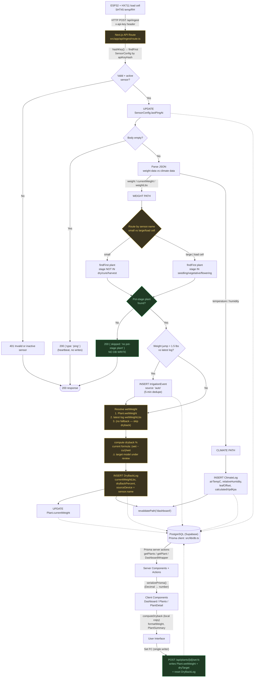

# Cultivators Ledger 
Take the guess work out of growing cannabis.
## Overview
A cultivation analytics suite for growers who want precision data and full control over their environment.
Key features:
- **Real-time VPD tracking** – Know exactly when your plants are breathing optimally
- **Crop steering analytics** – Track dry-back slopes to dial in irrigation
- **DIY hardware support** – Connect your own sensors 
- **Manual data entry** – Use it as a digital journal, even without sensors
- **Multi-room / multi-zone support** – Monitor different environments separately
- **CSV import** – Bring your existing spreadsheets into the system
## Architecture

Get Involved
- Report bugs – Open an issue with the bug label
- Suggest features – Open an issue with the enhancement label
- Submit code – Fork the repo and open a pull request
- Ask questions – Start a discussion (if enabled)
## ⭐ Support
If this project is useful to you, consider starring the repo to help others find it.
